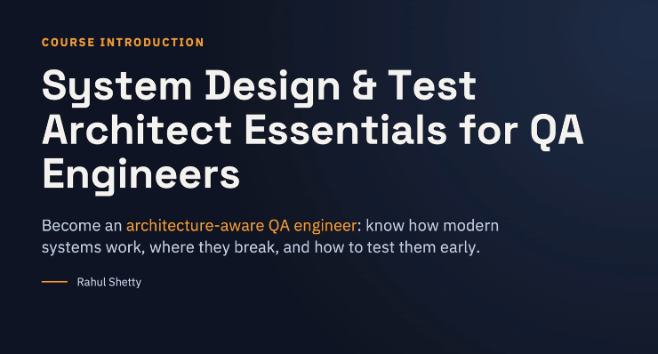
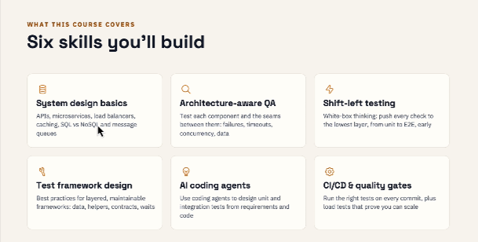
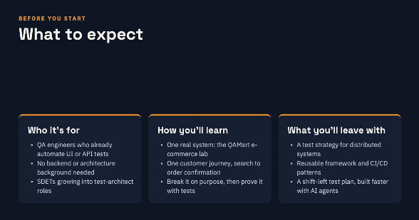
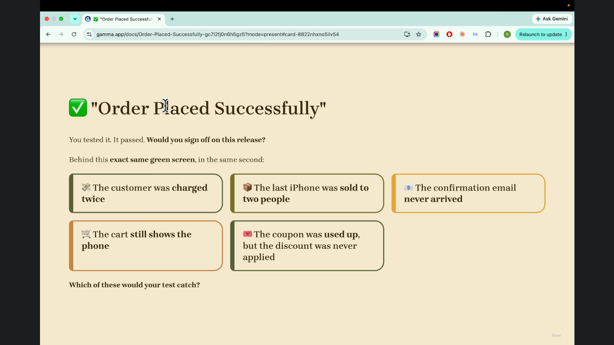
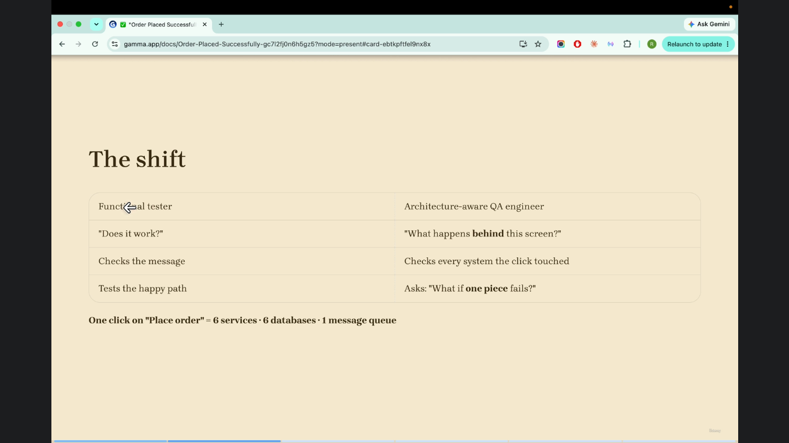
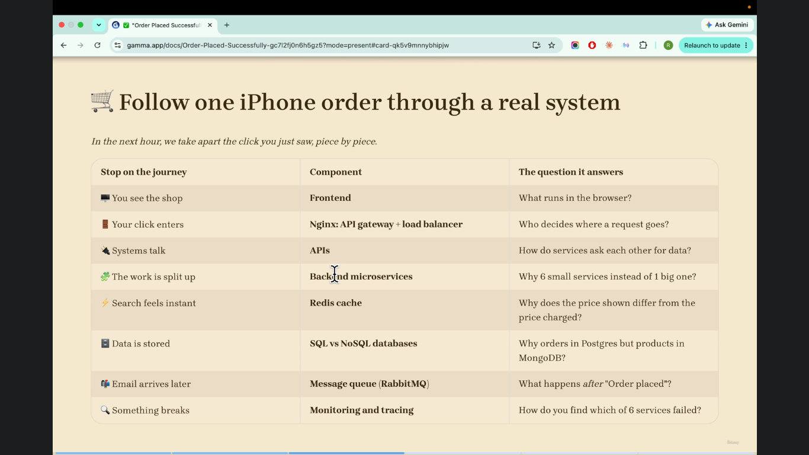
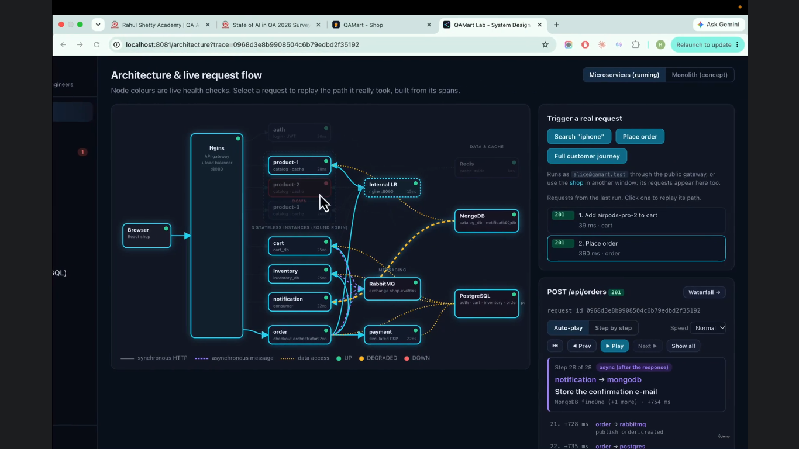

# Introduction - Why System Design Matters for QA Engineers

## What Essential Architect Skills this course covers? -Course Intro

## Why Is System Design Knowledge Essential for QA Engineers?

