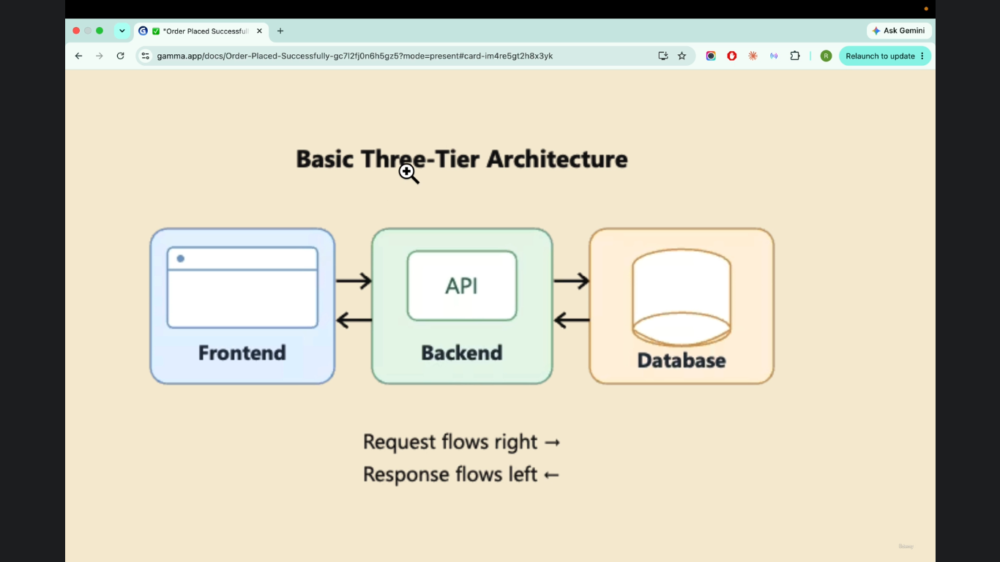
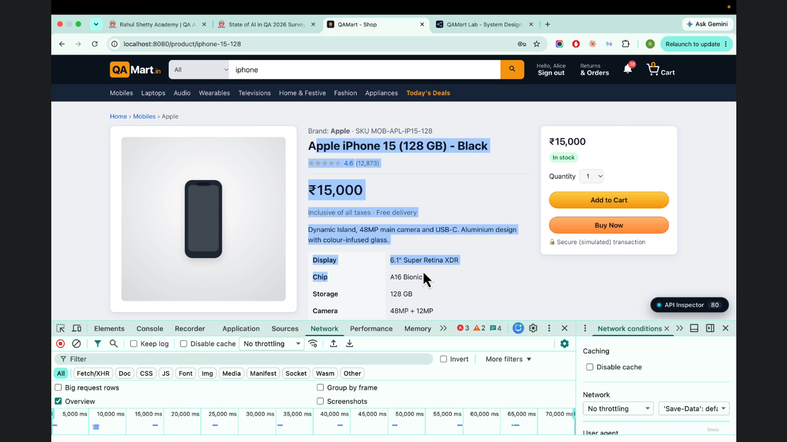
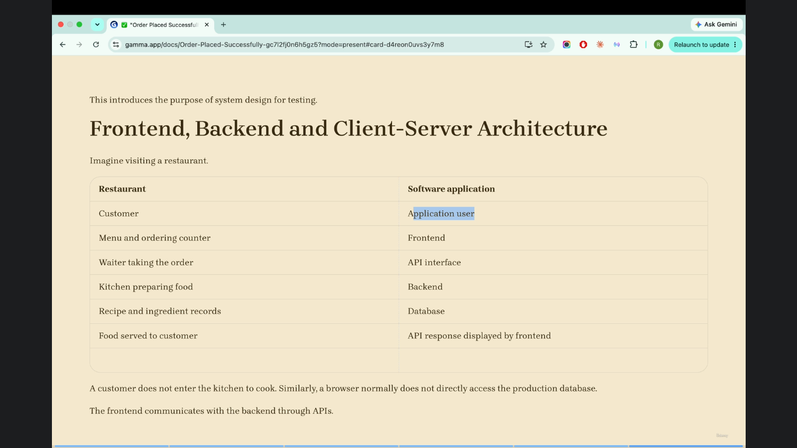
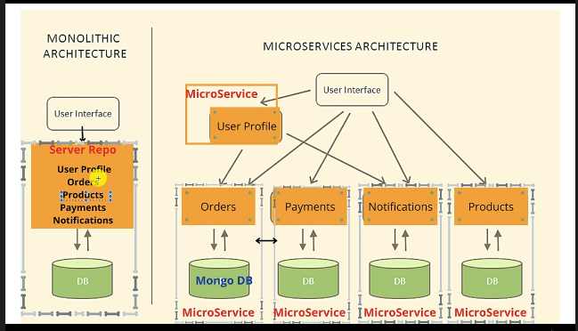

# Modern App Architecture — Client-Server, Microservices & Docker

## Introduction to Client Server 3 tier architecture for Modern Apps

> Now if you are if you want to be a good architectural aware guy you should know how your back end components are connected. That is very very important.  

## Introduction to Microservices driven backend Architecture and its advantages

